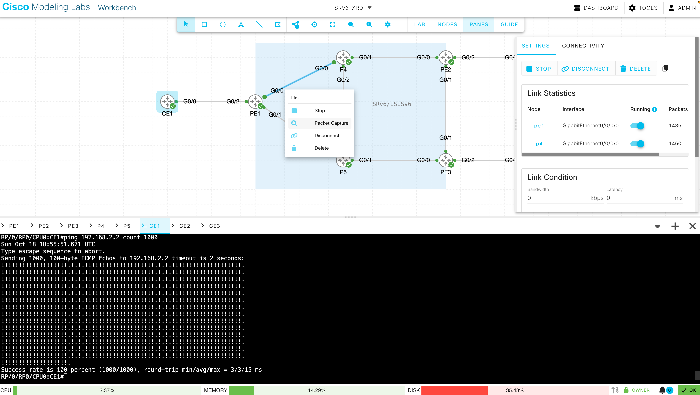
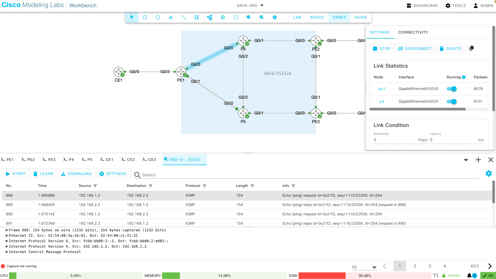
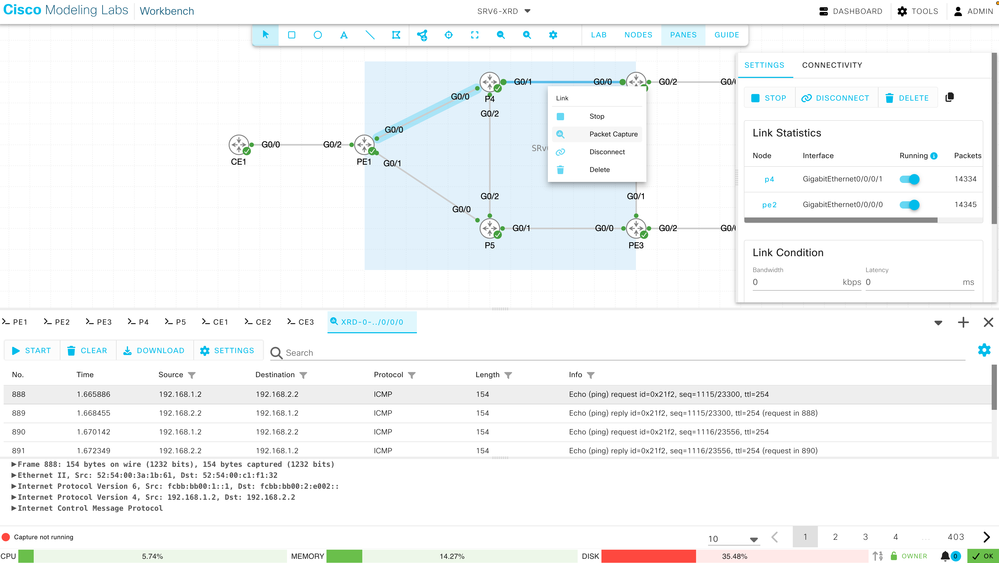
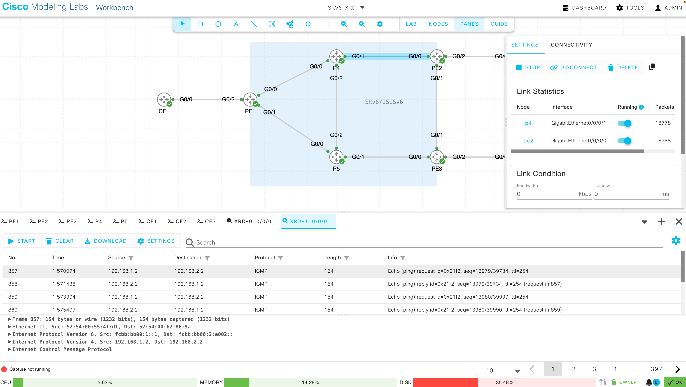

# 02. SRv6 L3VPN

## 2.1 VRF インスタンス設定

!!! abstract "ゴール"

```
VRF インスタンスを設定すること
```

PEルータ（PE1 ~ PE3）に VRF インスタンスを設定します。今回は、全て同じ設定を行います。

```
vrf CustA
 address-family ipv4 unicast
  import route-target
   100:100
  !
  export route-target
   100:100
  !
 !
!
```

## 2.2 CE向けインタフェース設定とローカルCEとの疎通確認

!!! abstract "ゴール"

```
PEとローカルCEと疎通が取れることを確認すること
```

各PEのCE向けインタフェースにはIPアドレスは設定されています。（PE1 ~ PE3）

```
RP/0/RP0/CPU0:PE1#show run int GigabitEthernet 0/0/0/2
Sun Oct 18 18:33:35.651 UTC
interface GigabitEthernet0/0/0/2
 ipv4 address 192.168.1.1 255.255.255.0
!
```

CE向けインタフェースに VRF を設定します。（PE1 ~ PE3）

```
interface GigabitEthernet 0/0/0/2
 vrf CustA
!
```

PEからローカルCE向けの疎通確認を行います。（PE1 ~ PE3）

Ping の宛先:

- PE1: 198.18.1.2
- PE2: 198.18.2.2
- PE3: 198.18.3.2

```
RP/0/RP0/CPU0:PE1#ping vrf CustA 192.168.1.2
Sun Oct 18 18:39:53.442 UTC
Type escape sequence to abort.
Sending 5, 100-byte ICMP Echos to 192.168.1.2 timeout is 2 seconds:
!!!!!
Success rate is 100 percent (5/5), round-trip min/avg/max = 2/2/5 ms
RP/0/RP0/CPU0:PE1#
```

VRF ルーティングテーブルの確認（PE1 ~ PE3）

リモートCEのIPアドレスは学習されていないことを確認します。

```
RP/0/RP0/CPU0:PE1#show ip route vrf CustA
Sun Oct 18 16:31:28.980 UTC

Gateway of last resort is not set

C    192.168.1.0/24 is directly connected, 00:00:47, GigabitEthernet0/0/0/2
L    192.168.1.1/32 is directly connected, 00:00:47, GigabitEthernet0/0/0/2
RP/0/RP0/CPU0:PE1#
```


## 2.3 MP-BGP 設定

!!! abstract "ゴール"

```
リモートPE間でBGPセッションを確立し、PEがリモートCEの経路をSRv6 SIDとともに学習すること。
```

リモートCE向けの疎通が通らないことを確認します。（PE1 ~ PE3）

```
RP/0/RP0/CPU0:PE1#ping vrf CustA 192.168.2.2
Sun Oct 18 18:40:21.945 UTC
Type escape sequence to abort.
Sending 5, 100-byte ICMP Echos to 192.168.2.2 timeout is 2 seconds:
UUUUU
Success rate is 0 percent (0/5)
RP/0/RP0/CPU0:PE1#
```

PE ルータにてBGP を設定（PE1 ~ PE3）

- router-id は、設定対象ルータの IPv4 ループバックアドレス (1.1.1.1, 2.2.2.2, 3.3.3.3)に変更してください。
- ネイバーアドレスは、他PEの IPv6 ループバックアドレス (fcbb:bb00:N::1) を設定してください。コア網は IPv6 のみのため、VPNv4 経路も IPv6 の BGP セッションで交換します。
- RDは通常共通した値を設定することを推奨しておりますが、今回は loopback:vpn-id (1.1.1.1:100 or 2.2.2.2:100 or 3.3.3.3:100) としています。
- VRF の `segment-routing srv6` 配下で、サービス SID を払い出す Locator と SID の割り当てモードを指定します。`alloc mode per-vrf` では、VRF 単位で 1 つの uDT4 SID が割り当てられます。

```
router bgp 65000
 bgp router-id 1.1.1.1
 address-family vpnv4 unicast
 !
 neighbor-group PEs
  remote-as 65000
  update-source Loopback0
  address-family vpnv4 unicast
  !
 !
 neighbor fcbb:bb00:2::1
  use neighbor-group PEs
 !
 neighbor fcbb:bb00:3::1
  use neighbor-group PEs
 !
 vrf CustA
  rd 1.1.1.1:100
  address-family ipv4 unicast
   segment-routing srv6
    locator MAIN
    alloc mode per-vrf
   !
   redistribute connected
  !
 !
!
```

PE間でBGPが上がっていることを確認します。（PE1 ~ PE3）

```
RP/0/RP0/CPU0:PE1#show bgp vpnv4 unicast summary 
Sun Oct 18 16:41:28.717 UTC
BGP router identifier 1.1.1.1, local AS number 65000
BGP generic scan interval 60 secs
Non-stop routing is enabled
BGP table state: Active
Table ID: 0x0
BGP main routing table version 2
BGP NSR Initial initsync version 18446744073709551615 (Not Reached)
BGP NSR/ISSU Sync-Group versions 0/0
BGP scan interval 60 secs

BGP is operating in STANDALONE mode.


Process    RcvTblVer     bRIB/RIB     LabelVer    ImportVer    SendTblVer   StandbyVer
Speaker            2             1             0             0             1             0

Neighbor        Spk    AS MsgRcvd MsgSent       TblVer  InQ OutQ  Up/Down  St/PfxRcd
fcbb:bb00:2::1    0 65000       2       2            0    0    0 00:00:37          0
fcbb:bb00:3::1    0 65000       2       2            0    0    0 00:00:11          0

RP/0/RP0/CPU0:PE1#
```

VRF CustA に対して割り当てられたローカルの SRv6 SID (uDT4) を確認します。（PE1 ~ PE3）

SR-MPLS では VPN ラベルが LFIB に登録されていましたが、SRv6 では Locator 配下の SID (Function) として VRF 用の SID が割り当てられます。uDT4 は「カプセル化を解除して、特定の VRF の IPv4 テーブルをルックアップする」という動作 (Behavior) を表します。

```
RP/0/RP0/CPU0:PE1#show segment-routing srv6 sid
Sun Oct 18 18:52:17.947 UTC

*** Locator: 'MAIN' *** 

SID                         Behavior          Identification                    Owner               State  RW
--------------------------  ----------------  --------------------------------  ------------------  -----  --
fcbb:bb00:1::               uN (PSP/USD)      'default':1                       sidmgr              InUse  Y 
fcbb:bb00:1:e000::          uA (PSP/USD)      [Gi0/0/0/0, Link-Local]:0         isis-core           InUse  Y 
fcbb:bb00:1:e001::          uA (PSP/USD)      [Gi0/0/0/1, Link-Local]:0         isis-core           InUse  Y 
fcbb:bb00:1:e002::          uDT4              'CustA'                           bgp-65000           InUse  Y 
RP/0/RP0/CPU0:PE1#
```

BGP でローカルに割り当てた SID 及びリモート PE から受け取った SID を確認します。（PE1 ~ PE3）

```
RP/0/RP0/CPU0:PE1#show bgp vpnv4 unicast local-sids 
Sun Oct 18 18:52:30.544 UTC
BGP router identifier 1.1.1.1, local AS number 65000
BGP generic scan interval 60 secs
Non-stop routing is enabled
BGP table state: Active
Table ID: 0x0
BGP main routing table version 16
BGP NSR Initial initsync version 5 (Not Reached)
BGP NSR/ISSU Sync-Group versions 0/0
BGP scan interval 60 secs

Status codes: s suppressed, d damped, h history, * valid, > best
              i - internal, r RIB-failure, S stale, N Nexthop-discard
Origin codes: i - IGP, e - EGP, ? - incomplete
   Network            Local Sid                                   Alloc mode   Locator
Route Distinguisher: 1.1.1.1:100 (default for vrf CustA)
Route Distinguisher Version: 16
*> 192.168.1.0/24     fcbb:bb00:1:e002::                          per-vrf       MAIN
*>i192.168.2.0/24     NO SRv6 Sid                                 -            -
*>i192.168.3.0/24     NO SRv6 Sid                                 -            -
Route Distinguisher: 2.2.2.2:100
Route Distinguisher Version: 13
*>i192.168.2.0/24     NO SRv6 Sid                                 -            -
Route Distinguisher: 3.3.3.3:100
Route Distinguisher Version: 15
*>i192.168.3.0/24     NO SRv6 Sid                                 -            -

Processed 5 prefixes, 5 paths
RP/0/RP0/CPU0:PE1#
RP/0/RP0/CPU0:PE1#
RP/0/RP0/CPU0:PE1#show bgp vpnv4 unicast received-sids 
Sun Oct 18 18:52:41.136 UTC
BGP router identifier 1.1.1.1, local AS number 65000
BGP generic scan interval 60 secs
Non-stop routing is enabled
BGP table state: Active
Table ID: 0x0
BGP main routing table version 16
BGP NSR Initial initsync version 5 (Not Reached)
BGP NSR/ISSU Sync-Group versions 0/0
BGP scan interval 60 secs

Status codes: s suppressed, d damped, h history, * valid, > best
              i - internal, r RIB-failure, S stale, N Nexthop-discard
Origin codes: i - IGP, e - EGP, ? - incomplete
   Network            Next Hop                            Received Sid
Route Distinguisher: 1.1.1.1:100 (default for vrf CustA)
Route Distinguisher Version: 16
*> 192.168.1.0/24     0.0.0.0                             NO SRv6 Sid
*>i192.168.2.0/24     fcbb:bb00:2::1                      fcbb:bb00:2:e002::
*>i192.168.3.0/24     fcbb:bb00:3::1                      fcbb:bb00:3:e002::
Route Distinguisher: 2.2.2.2:100
Route Distinguisher Version: 13
*>i192.168.2.0/24     fcbb:bb00:2::1                      fcbb:bb00:2:e002::
Route Distinguisher: 3.3.3.3:100
Route Distinguisher Version: 15
*>i192.168.3.0/24     fcbb:bb00:3::1                      fcbb:bb00:3:e002::

Processed 5 prefixes, 5 paths
RP/0/RP0/CPU0:PE1#
```

CEF VRFを確認します。（PE1 ~ PE3）

例えば、PE1にてPE2に接続しているCE向けのCEFテーブルを確認すると、PE2 の uDT4 SID (fcbb:bb00:2:e002::) を宛先とする IPv6 ヘッダでカプセル化 (H.Encaps.Red) され、PE2 の Locator (fcbb:bb00:2::/48) 向けの経路に従って転送されることがわかります。SR-MPLS のように Transport 用と VPN 用の 2 段のラベルを付与するのではなく、1 つの IPv6 ヘッダのみで転送されます。

```
RP/0/RP0/CPU0:PE1#show cef vrf CustA 192.168.2.2
Sun Oct 18 18:53:16.708 UTC
192.168.2.0/24, version 7, SRv6 Headend, internal 0x5000001 0x30 (ptr 0x8aae8830) [1], 0x0 (0x0), 0x0 (0x8a7dd408)
 Updated Oct 18 18:52:05.021
 Prefix Len 24, traffic index 0, precedence n/a, priority 3
  gateway array (0x8aaeb098) reference count 1, flags 0x2010, source rib (7), 0 backups
                [1 type 3 flags 0x48441 (0x893937d0) ext 0x0 (0x0)]
  LW-LDI[type=0, refc=0, ptr=0x0, sh-ldi=0x0]
  gateway array update type-time 1 Oct 18 18:52:05.021
 LDI Update time Oct 18 18:52:05.033

  Level 1 - Load distribution: 0
  [0] via fcbb:bb00:2::/128, recursive

   via fcbb:bb00:2::/128, 3 dependencies, recursive [flags 0x6000]
    path-idx 0 NHID 0x0 [0x88322588 0x0]
    next hop VRF - 'default', table - 0xe0800000
    next hop fcbb:bb00:2::/128 via fcbb:bb00:2::/48
    SRv6 H.Encaps.Red SID-list {fcbb:bb00:2:e002::}

    Load distribution: 0 (refcount 1)

    Hash  OK  Interface                 Address
    0     Y   GigabitEthernet0/0/0/0    fe80::5054:ff:fec1:f132

RP/0/RP0/CPU0:PE1#
```

一方で、PE1にてPE3に接続しているCE3向けのCEFテーブルを確認すると、PE3 の uDT4 SID (fcbb:bb00:3:e002::) でカプセル化され、P5 方向 (FourHundredGigE0/0/0/1) に転送されることがわかります。

```
RP/0/RP0/CPU0:PE1#show cef vrf CustA 192.168.3.2
Sun Oct 18 18:54:43.047 UTC
192.168.3.0/24, version 8, SRv6 Headend, internal 0x5000001 0x30 (ptr 0x8aae8750) [1], 0x0 (0x0), 0x0 (0x8a7dd458)
 Updated Oct 18 18:52:05.033
 Prefix Len 24, traffic index 0, precedence n/a, priority 3
  gateway array (0x8aaeb1a0) reference count 1, flags 0x2010, source rib (7), 0 backups
                [1 type 3 flags 0x48441 (0x89393828) ext 0x0 (0x0)]
  LW-LDI[type=0, refc=0, ptr=0x0, sh-ldi=0x0]
  gateway array update type-time 1 Oct 18 18:52:05.032
 LDI Update time Oct 18 18:52:05.032

  Level 1 - Load distribution: 0
  [0] via fcbb:bb00:3::/128, recursive

   via fcbb:bb00:3::/128, 3 dependencies, recursive [flags 0x6000]
    path-idx 0 NHID 0x0 [0x895a8360 0x0]
    next hop VRF - 'default', table - 0xe0800000
    next hop fcbb:bb00:3::/128 via fcbb:bb00:3::/48
    SRv6 H.Encaps.Red SID-list {fcbb:bb00:3:e002::}

    Load distribution: 0 (refcount 1)

    Hash  OK  Interface                 Address
    0     Y   GigabitEthernet0/0/0/1    fe80::5054:ff:febb:bec1

RP/0/RP0/CPU0:PE1#
```


Egress PE 側の動作も確認します。PE1 自身の uDT4 SID (fcbb:bb00:1:e002::) の CEF エントリを確認すると、この SID 宛のパケットはカプセル化を解除した上で、VRF CustA のテーブルでルックアップされることがわかります。（PE1 ~ PE3）

```
RP/0/RP0/CPU0:PE1#show cef ipv6 fcbb:bb00:1:e002::/64
Sun Oct 18 18:55:01.071 UTC
fcbb:bb00:1:e002::/64, version 49, SRv6 Endpoint uDT4, internal 0x5000001 0x40 (ptr 0x883222e8) [1], 0x400 (0x89711bd8), 0x0 (0x8a7dd3b8)
 Updated Oct 18 18:50:12.837
 Prefix Len 64, traffic index 0, precedence n/a, priority 4
  gateway array (0x895ab5b8) reference count 1, flags 0x0, source rib (7), 0 backups
                [2 type 3 flags 0x8401 (0x8964dca0) ext 0x0 (0x0)]
  LW-LDI[type=3, refc=1, ptr=0x89711bd8, sh-ldi=0x8964dca0]
  gateway array update type-time 1 Oct 18 18:50:12.837
 LDI Update time Oct 18 18:50:12.837
 LW-LDI-TS Oct 18 18:50:12.837
   via ::ffff:0.0.0.0/128, 0 dependencies, weight 0, class 0 [flags 0x0]
    path-idx 0 NHID 0x0 [0x88ce8108 0x0]
    next hop VRF - 'CustA', table - 0xe0000001
    next hop ::ffff:0.0.0.0/128

    Load distribution: 0 (refcount 2)

    Hash  OK  Interface                 Address
    0     Y   recursive                 Lookup in table
RP/0/RP0/CPU0:PE1#
```

リモートPEのCE向けインタフェース宛にPingを実施します。（PE1 ~ PE3）

PE間はSRv6でカプセル化されて転送されるため、VRF CustA内で疎通できることがわかります。

```
RP/0/RP0/CPU0:PE1#ping vrf CustA 192.168.2.2
Sun Oct 18 18:55:17.517 UTC
Type escape sequence to abort.
Sending 5, 100-byte ICMP Echos to 192.168.2.2 timeout is 2 seconds:
!!!!!
Success rate is 100 percent (5/5), round-trip min/avg/max = 4/9/29 ms
RP/0/RP0/CPU0:PE1#
```


## 2.4 VPN トラフィック確認

!!! abstract "ゴール"

```
VPNトラフィックがSRv6ネットワーク上をどのように流れているかを確認すること
```

CE1 から CE2 に対して継続的にPingを打ち続けます。

```text
ping 192.168.2.2 count 1000
```

CML にて、PE1とP4の間のリンクを右クリックし、Packet Captureを選択します。

Start をクリックするとパケットキャプチャを開始します。Stop で停止します。

{ style="width:100%" }

Source: 192.168.1.2, Destination: 192.168.2.2, Protocol: ICMP のパケットをクリックすると、詳細が表示されます。PE1からP4へ、元の IPv4 パケットが Outer IPv6 ヘッダ（Source: fcbb:bb00:1::1、Destination: PE2 の uDT4 SID fcbb:bb00:2:e002::、Next Header: IPIP (4)）でカプセル化された上で転送されていることがわかります。uSID が 1 つのみのため、SR ヘッダ (SRH) は付与されていません。

{ style="width:100%" }

次に、P4からPE2間のリンクを右クリックし、Packet Captureを選択します。

{ style="width:100%" }

Start でパケットキャプチャを開始し、Source: 192.168.1.2, Destination: 192.168.2.2 Protocol: ICMP のパケットをクリックします。P4 は Outer IPv6 ヘッダの宛先 (fcbb:bb00:2:e002::) に対して PE2 の Locator (fcbb:bb00:2::/48) をロンゲストマッチで検索し、通常の IPv6 パケットとして転送するだけのため、宛先アドレスは変化していないことがわかります。SR-MPLS の PHP のように途中でヘッダが取り除かれることはなく、Egress PE である PE2 でカプセル化が解除されます。

{ style="width:100%" }

CE1 にてCtrl＋CでPingを止めます。

時間に余裕がありましたら、CE1からPE3に接続する192.168.3.2向けにPingを実施して、パケットキャプチャを実施してみてください。宛先アドレスはPE3 の uDT4 SID (fcbb:bb00:3:e002::) となります。