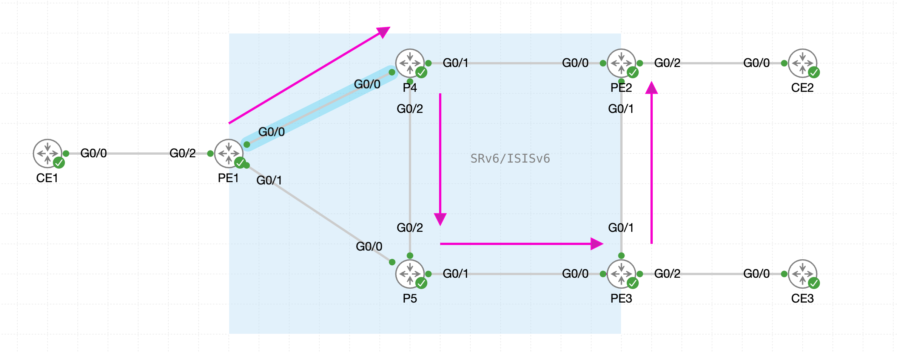
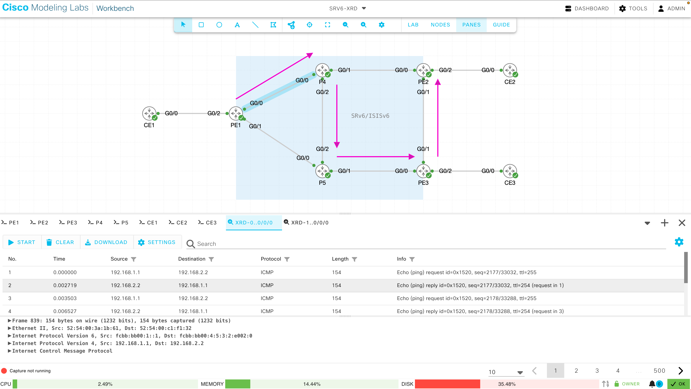
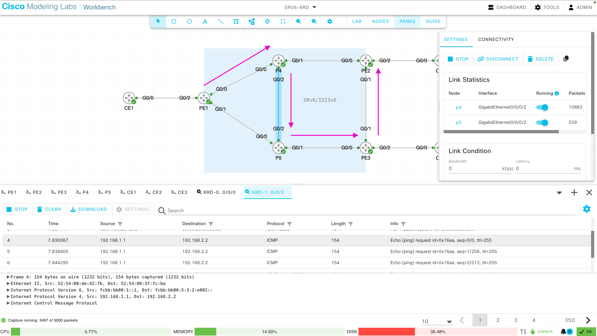
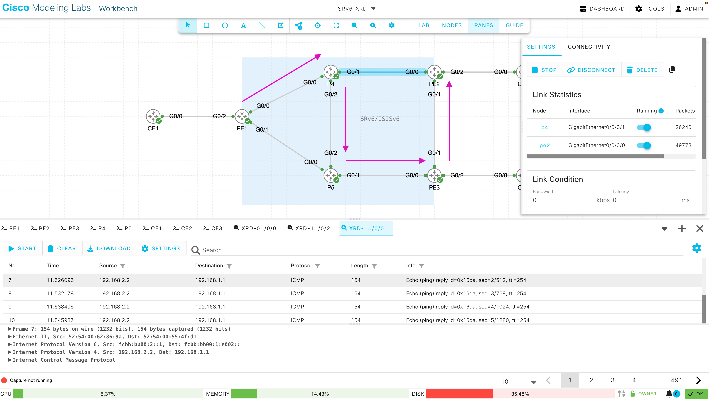

# 03. SRv6-TE Explicit Path

## 3.1 SR-TE DB設定

!!! abstract "ゴール"

```
ヘッドエンドがパス計算を行うためのSR-TE DBの構築
```

今回は、PE1からPE2向けのトラフィックが下記のような経路を通るようにExplicit Pathを設定します。

{ style="width:100%" }

ヘッドエンドではパス計算を行うため SR-TE DB を利用します。デフォルトでは、下記のようにSR-TE DBには何もデータが存在しません。

```
RP/0/RP0/CPU0:PE1#show segment-routing traffic-eng topology
Sun Oct 18 19:00:47.616 UTC
RP/0/RP0/CPU0:PE1#
```

今回ヘッドエンドとなるPE1にて下記のように設定し、IS-IS のリンクステートデータベース (LSDB) がSR-TE DB にフィードされるようにします。

```
router isis core
 distribute link-state
!
```

設定後、再度SR-TE DBを表示すると、下記のようにSR-TEパス計算に必要なトポロジーデータベースが確認できるようになったことがわかります。SR-MPLS の SRGB や Prefix SID の代わりに、各ノードの SRv6 Locator、uN SID、及びリンクごとの uA SID が登録されています。

```
RP/0/RP0/CPU0:PE1#show segment-routing traffic-eng topology
Sun Oct 18 19:01:08.055 UTC

Topology database:
------------------
Node 2
  IPv6 Router ID: fcbb:bb00:1::1
  Num Anycast Prefixes: 0
  ISIS-L2 0000.0000.0001
    Hostname: PE1
    IPv6 router ID: fcbb:bb00:1::1
    ISIS area ID: 49.0001

    Prefixes:
      fcbb:bb00:1::/48
      fcbb:bb00:1::1/128

    Node SIDs:
      SID: fcbb:bb00:1:: Behavior: uN (PSP/USD) (48) algorithm: 0
        SID Structure:
          Block Length: 32, Node-ID Length: 16
          Function Length: 0, Arguments Length: 80

    Links:
      Local: unnumbered index 3 Remote: unnumbered index 4
        Remote node: ISIS-L2 0000.0000.0004
          Hostname: P4
          IPv6 router ID: fcbb:bb00:4::1
          ISIS area ID: 49.0001
        Metrics: IGP 10
        Bandwidth: Total 125000000 Bps, Reservable 0 Bps
        Adjacency SIDs:
          SID: fcbb:bb00:1:e000:: Behavior: uA (PSP/USD) (57) algorithm: 0
            SID Structure:
              Block Length: 32, Node-ID Length: 16
              Function Length: 16, Arguments Length: 64

      Local: unnumbered index 4 Remote: unnumbered index 4
        Remote node: ISIS-L2 0000.0000.0005
          Hostname: P5
          IPv6 router ID: fcbb:bb00:5::1
          ISIS area ID: 49.0001
        Metrics: IGP 10
        Bandwidth: Total 125000000 Bps, Reservable 0 Bps
        Adjacency SIDs:
          SID: fcbb:bb00:1:e001:: Behavior: uA (PSP/USD) (57) algorithm: 0
            SID Structure:
              Block Length: 32, Node-ID Length: 16
              Function Length: 16, Arguments Length: 64

Node 4
  IPv6 Router ID: fcbb:bb00:2::1
  Num Anycast Prefixes: 0
  ISIS-L2 0000.0000.0002
    Hostname: PE2
    IPv6 router ID: fcbb:bb00:2::1
    ISIS area ID: 49.0001
< --- omitted --- >
```


## 3.2 Explicit Path 設定

!!! abstract "ゴール"

```
PE1からPE2向けのExplicit-Pathの設定
```

PE1からPE2向けのトラフィックが下記のような経路を通るようにSIDリストを作成し、Explicit Pathを設定します。

{ style="width:100%" }

事前にP4とP5でもSRv6を有効にしておきます。

```
segment-routing
 srv6
  encapsulation
   source-address fcbb:bb00:4::1
  !
  locators
   locator MAIN
    micro-segment behavior unode psp-usd
    prefix fcbb:bb00:4::/48
   !
  !
 !
!
router isis core
 address-family ipv6 unicast
  segment-routing srv6
   locator MAIN
   !
  !
 !
!
```

ヘッドエンドとなるPE1に下記のように設定を行います。

- SR-MPLS では Prefix SID のラベル (16004 など) を並べていましたが、SRv6 では各ノードの uN SID (fcbb:bb00:4:: など) を並べます。
- 
- SRv6-TE ポリシーのエンドポイントには、リモート PE の IPv6 ループバックアドレス (BGP ネクストホップ) を指定します。

```
segment-routing
 traffic-eng
  srv6
  !
  segment-lists
   srv6
    sid-format usid-f3216
   !
   segment-list SIDLIST1
    srv6
     index 10 sid fcbb:bb00:4::
     index 20 sid fcbb:bb00:5::
     index 30 sid fcbb:bb00:3::
     index 40 sid fcbb:bb00:2::
    !
   !
  !
  policy POLICY1
   srv6
    binding-sid dynamic behavior ub6-psp-usd-insert-reduced locator MAIN
   !
   color 10 end-point ipv6 fcbb:bb00:2::1
   candidate-paths
    preference 100
     explicit segment-list SIDLIST1
     !
    !
   !
  !
 !
!

```

SRv6-TE ポリシーの状態を確認し、Operational StateがUpしていることを確認します。

また、Binding SIDも確認できます。

```
RP/0/RP0/CPU0:PE1#show segment-routing traffic-eng policy detail
Sun Oct 18 19:06:09.307 UTC

SR-TE policy database
---------------------

Color: 10, End-point: fcbb:bb00:2::1
  Name: srte_c_10_ep_fcbb:bb00:2::1
  Status:
    Admin: up  Operational: up for 00:00:10 (since Oct 18 19:05:59.152)
  Candidate-paths:
    Preference: 100 (configuration) (active)
      Name: POLICY1
      Requested BSID: dynamic
      Constraints:
        Protection Type: protected-preferred
        Maximum SID Depth: 25 
      Explicit: segment-list SIDLIST1 (valid)
        Weight: 1, Metric Type: TE (IANA PCEP/IGP: 2/2)
          SID[0]: fcbb:bb00:4::/48
                  Format: f3216
                  LBL:32 LNL:16 FL:0 AL:80
          SID[1]: fcbb:bb00:5::/48
                  Format: f3216
                  LBL:32 LNL:16 FL:0 AL:80
          SID[2]: fcbb:bb00:3::/48
                  Format: f3216
                  LBL:32 LNL:16 FL:0 AL:80
          SID[3]: fcbb:bb00:2::/48
                  Format: f3216
                  LBL:32 LNL:16 FL:0 AL:80
      SRv6 Information: 
        Locator: MAIN
        Binding SID requested: Dynamic
        Binding SID behavior: uB6 (PSP/USD Insert.Red)
        Explicit binding SID enforced: No
        Install Final Node SID: No
  LSPs:
    LSP[0]:
      LSP-ID: 2 policy ID: 2 (active)
      State: Programmed
      Binding SID: fcbb:bb00:1:e003::
  Attributes:
    Binding SID: fcbb:bb00:1:e003::
    Forward Class: Not Configured
    Steering services disabled: no
    Steering BGP disabled: no
    IPv6 caps enable: yes
    Invalidation drop enabled: no
    Max Install Standby Candidate Paths: 0
    Path Type: SRV6

RP/0/RP0/CPU0:PE1#
```

SRv6 SID の一覧でも、Binding SID (uB6) が SRv6-TE ポリシーに割り当てられていることを確認できます。

```
RP/0/RP0/CPU0:PE1#show segment-routing srv6 sid
Sun Oct 18 19:06:33.322 UTC

*** Locator: 'MAIN' *** 

SID                         Behavior          Identification                    Owner               State  RW
--------------------------  ----------------  --------------------------------  ------------------  -----  --
fcbb:bb00:1::               uN (PSP/USD)      'default':1                       sidmgr              InUse  Y 
fcbb:bb00:1:e000::          uA (PSP/USD)      [Gi0/0/0/0, Link-Local]:0         isis-core           InUse  Y 
fcbb:bb00:1:e001::          uA (PSP/USD)      [Gi0/0/0/1, Link-Local]:0         isis-core           InUse  Y 
fcbb:bb00:1:e002::          uDT4              'CustA'                           bgp-65000           InUse  Y 
fcbb:bb00:1:e003::          uB6 (PSP/USD Insert.Red)  'srte_c_10_ep_fcbb:bb00:2::1' (10, fcbb:bb00:2::1)  xtc_srv6            InUse  Y 
RP/0/RP0/CPU0:PE1#
```

Binding SID の CEF エントリを確認すると、SIDリストの 4 つの uSID (0004, 0005, 0003, 0002) が 1 つの uSID キャリア (fcbb:bb00:4:5:3:2::) に圧縮されてプログラムされていることがわかります。F3216 フォーマットでは、1 つの uSID キャリア (128 bit) に最大 6 つの uSID を格納できるため、このパスでは SR ヘッダ (SRH) は不要です。

```
RP/0/RP0/CPU0:PE1#show cef ipv6 fcbb:bb00:1:e003::
Sun Oct 18 19:06:49.828 UTC
fcbb:bb00:1:e003::/80, version 62, SRv6 Endpoint uB6 (PSP/USD Insert.Red), internal 0x1000001 0x200 (ptr 0x895a80c0) [1], 0x400 (0x89711d58), 0x0 (0x8a7dd4f8)
 Updated Oct 18 19:05:59.154 
 local adjacency to GigabitEthernet0/0/0/0

 Prefix Len 80, traffic index 0, precedence n/a, priority 0
  gateway array (0x895ab6c0) reference count 2, flags 0x0, source rib (7), 0 backups
                [3 type 3 flags 0x8401 (0x8964dcf8) ext 0x0 (0x0)]
  LW-LDI[type=3, refc=1, ptr=0x89711d58, sh-ldi=0x8964dcf8]
  gateway array update type-time 1 Oct 18 19:05:59.154
 LDI Update time Oct 18 19:05:59.213
 LW-LDI-TS Oct 18 19:05:59.213
 Accounting: 0/0 packets/bytes output (per-prefix-per-path mode)
   via fe80::5054:ff:fec1:f132/128, GigabitEthernet0/0/0/0, 9 dependencies, weight 0, class 0 [flags 0x0]
    path-idx 0 NHID 0x20003 [0x8a767340 0x0]
    next hop fe80::5054:ff:fec1:f132/128
    local adjacency
    Accounting: 0/0 packets/bytes output
    SRv6 H.Insert.Red SID-list {fcbb:bb00:4:5:3::}

    Load distribution: 0 (refcount 3)

    Hash  OK  Interface                 Address
    0     Y   GigabitEthernet0/0/0/0    fe80::5054:ff:fec1:f132
RP/0/RP0/CPU0:PE1#
```


## 3.3 Automated Steering 設定

!!! abstract "ゴール"

```
PE1からPE2向けのVPNトラフィックがSRv6-TEポリシーに従って転送されるようにすること
```

現在、PE2（fcbb:bb00:2::1）向けのVPNトラフィックの経路はSRv6-TEポリシーに載っておらず、IGP最短パス (P4 方向) で転送されることを確認します。

```
RP/0/RP0/CPU0:PE1#show cef vrf CustA 192.168.2.2
Sun Oct 18 19:10:16.748 UTC
192.168.2.0/24, version 3, SRv6 Headend, internal 0x5000001 0x30 (ptr 0x8ab02830) [1], 0x0 (0x0), 0x0 (0x8aa18408)
 Updated Oct 18 19:10:03.016
 Prefix Len 24, traffic index 0, precedence n/a, priority 3
  gateway array (0x8ab05098) reference count 1, flags 0x2010, source rib (7), 0 backups
                [1 type 3 flags 0x48441 (0x8937d7d0) ext 0x0 (0x0)]
  LW-LDI[type=0, refc=0, ptr=0x0, sh-ldi=0x0]
  gateway array update type-time 1 Oct 18 19:10:03.016
 LDI Update time Oct 18 19:10:03.026

  Level 1 - Load distribution: 0
  [0] via fcbb:bb00:2::/128, recursive

   via fcbb:bb00:2::/128, 3 dependencies, recursive [flags 0x6000]
    path-idx 0 NHID 0x0 [0x87e5c3c8 0x0]
    next hop VRF - 'default', table - 0xe0800000
    next hop fcbb:bb00:2::/128 via fcbb:bb00:2::/48
    SRv6 H.Encaps.Red SID-list {fcbb:bb00:2:e002::}

    Load distribution: 0 (refcount 1)

    Hash  OK  Interface                 Address
    0     Y   GigabitEthernet0/0/0/0    fe80::5054:ff:fec1:f132

RP/0/RP0/CPU0:PE1#
```

SRv6-TE ポリシーのエンドポイントである**PE2**にて、Color, Route-Policy を設定し BGP に適用します。下記の設定では、PE2から他のPE向けにBGPで広報されるすべてのVPNv4ルートに対して、Color:10 が付加されます。

```
extcommunity-set opaque PINK
  10
end-set
!
route-policy SET_COLOR
  set extcommunity color PINK
end-policy
!
router bgp 65000
 neighbor-group PEs
  address-family vpnv4 unicast
   route-policy SET_COLOR out
  !
 !
```

PE1にて、show bgp vrfで確認すると、PE2から広報されたリモートCEのプレフィックス198.18.11.0/24 には、BGP color extended community 10 が付加されており、Color 10 、 Binding SID fcbb:bb00:1:e003:: の SRv6-TE ポリシーに関連付けられていることがわかります。また、PE2 の uDT4 SID (fcbb:bb00:2:e002::) も BGP の Prefix-SID 属性で受信していることがわかります。

```
RP/0/RP0/CPU0:PE1#show bgp vrf CustA 192.168.2.2
Sun Oct 18 19:11:17.776 UTC
BGP routing table entry for 192.168.2.0/24, Route Distinguisher: 1.1.1.1:100
Versions:
  Process           bRIB/RIB   SendTblVer
  Speaker                 12           12
Last Modified: Oct 18 19:10:54.646 for 00:00:23
Paths: (1 available, best #1)
  Not advertised to any peer
  Path #1: Received by speaker 0
  Not advertised to any peer
  Local
    fcbb:bb00:2::1 (metric 20) from fcbb:bb00:2::1 (2.2.2.2)
      Received Label 0xe0020
      Origin incomplete, metric 0, localpref 100, valid, internal, best, group-best, import-candidate, imported
      Received Path ID 0, Local Path ID 1, version 12
      Extended community: Color:10 RT:100:100 
      PSID-Type:L3, SubTLV Count:1
       SID Locator: fcbb:bb00:2::/48, RIB metric: 21
       SubTLV:
        T:1(Sid information), Sid:fcbb:bb00:2::(Transposed), Behavior:63, SS-TLV Count:1
         SubSubTLV:
          T:1(Sid structure):
      Source AFI: VPNv4 Unicast, Source VRF: default, Source Route Distinguisher: 2.2.2.2:100
RP/0/RP0/CPU0:PE1#
RP/0/RP0/CPU0:PE1#show bgp vrf CustA ipv4 unicast 
Sun Oct 18 19:11:46.148 UTC
BGP VRF CustA, state: Active
BGP Route Distinguisher: 1.1.1.1:100
VRF ID: 0x60000001
BGP router identifier 1.1.1.1, local AS number 65000
Non-stop routing is enabled
BGP table state: Active
Table ID: 0xe0000001   RD version: 13
BGP main routing table version 14
BGP NSR Initial initsync version 9 (Not Reached)
BGP NSR/ISSU Sync-Group versions 0/0

Status codes: s suppressed, d damped, h history, * valid, > best
              i - internal, r RIB-failure, S stale, N Nexthop-discard
Origin codes: i - IGP, e - EGP, ? - incomplete
   Network            Next Hop            Metric LocPrf Weight Path
Route Distinguisher: 1.1.1.1:100 (default for vrf CustA)
Route Distinguisher Version: 13
*> 192.168.1.0/24     0.0.0.0                  0         32768 ?
*>i192.168.2.0/24     fcbb:bb00:2::1 C:10
                                               0    100      0 ?
*>i192.168.3.0/24     fcbb:bb00:3::1           0    100      0 ?

Processed 3 prefixes, 3 paths
RP/0/RP0/CPU0:PE1#
```

これにより、SRv6-TE ポリシーのColorと一致する宛先向けのトラフィックはSRv6-TE ポリシーのパスにて転送されるようになります。

CEF を確認すると、VRF のルートが Binding SID (fcbb:bb00:1:e003::) を経由するようになり、サービス SID (uDT4) によるカプセル化 (H.Encaps.Red) に加えて、SRv6-TE ポリシーの SIDリスト (H.Insert.Red) が適用されることがわかります。

```
RP/0/RP0/CPU0:PE1#show cef vrf CustA 192.168.2.2
Sun Oct 18 19:12:26.044 UTC
192.168.2.0/24, version 8, SRv6 Headend, internal 0x5000001 0x30 (ptr 0x8ab02830) [1], 0x0 (0x0), 0x0 (0x8aa18408)
 Updated Oct 18 19:11:41.157
 Prefix Len 24, traffic index 0, precedence n/a, priority 3
  gateway array (0x8ab052a8) reference count 1, flags 0x2010, source rib (7), 0 backups
                [1 type 3 flags 0x48441 (0x8937d880) ext 0x0 (0x0)]
  LW-LDI[type=0, refc=0, ptr=0x0, sh-ldi=0x0]
  gateway array update type-time 1 Oct 18 19:11:41.157
 LDI Update time Oct 18 19:11:41.157

  Level 1 - Load distribution: 0
  [0] via fcbb:bb00:1:e003::/128, recursive

   via local-srv6-sid fcbb:bb00:1:e003::, 3 dependencies, recursive [flags 0x6000]
    path-idx 0 NHID 0x0 [0x895660c0 0x0]
    recursion-via-/64
    next hop VRF - 'default', table - 0xe0800000
    next hop fcbb:bb00:1:e003:: via fcbb:bb00:1:e003::/80
    SRv6 H.Encaps.Red SID-list {fcbb:bb00:2:e002::}
      SRv6 H.Insert.Red SID-list {fcbb:bb00:4:5:3::}

    Load distribution: 0 (refcount 1)

    Hash  OK  Interface                 Address
    0     Y   GigabitEthernet0/0/0/0    fe80::5054:ff:fec1:f132

RP/0/RP0/CPU0:PE1#
```

また、SRポリシーのTracerouteを下記のように実行し、経路を確認することも可能です。

```
RP/0/RP0/CPU0:PE1#traceroute segment-routing srv6 policy name srte_c_10_ep_fcbb:bb00:2::1 probe 1
Sun Oct 18 19:14:16.336 UTC

Type escape sequence to abort.
Tracing the route to srte_c_10_ep_fcbb:bb00:2::1

 1  fcbb:bb00:4::1
        [IP tunnel: DA=fcbb:bb00:4:: SRH Stack 0 =(fcbb:bb00:5:3:2::   ,SL=1)   ]
        [IP tunnel: DA=fcbb:bb00:4:: SRH Stack 1 =(fcbb:bb00:5:3:2::   ,SL=0)   ] 3 msec
 2  fcbb:bb00:5::1
        [IP tunnel: DA=fcbb:bb00:5:3:2:: SRH Stack 0 =(fcbb:bb00:5:3:2::   ,SL=0)       ] 3 msec
 3  fcbb:bb00:3::1
        [IP tunnel: DA=fcbb:bb00:3:2:: SRH Stack 0 =(fcbb:bb00:5:3:2::   ,SL=0) ] 4 msec
 4  fcbb:bb00:2::1
        [IP tunnel: DA=fcbb:bb00:2:: SRH Stack 0 =(fcbb:bb00:5:3:2::   ,SL=0)   ] 6 msec
RP/0/RP0/CPU0:PE1#
```


## 3.4 パケットキャプチャ

!!! abstract "ゴール"

```
PE1からPE2向けのトラフィックが uSID によりどのように転送されるかをキャプチャする
```

設定したSRv6-TE ポリシーのパスが通るリンクでパケットキャプチャを開始します。

{ style="width:100%" }

そして、PE1にて192.168.2.2向けにPingを行います。

```
RP/0/RP0/CPU0:PE1#ping vrf CustA 192.168.2.2 count 10000              
Sun Oct 18 19:15:45.442 UTC
Type escape sequence to abort.
Sending 10000, 100-byte ICMP Echos to 192.168.2.2 timeout is 2 seconds:
!!!!!!!!!!!!!!!!!!!!!!!!!!!!!!!!!!!!!!!!!!!!!!!!!!!!!!!!!!!!!!!!!!!!!!
!!!!!!!!!!!!!!!!!!!!!!!!!!!!!!
```

例えば、PE1からP4の間のパケットキャプチャを確認すると、PE1からのICMP requestの Outer IPv6 ヘッダの宛先アドレスに、SRv6-TE ポリシーの uSID とサービス SID がまとめて格納されていることがわかります（例: fcbb:bb00:**4:5:3:2:e002**::）。

{ style="width:100%" }

P4からP5の間では、P4 が自身の uSID (0004) を取り除いて残りを左にシフトする (Shift and Forward) ため、宛先アドレスが fcbb:bb00:**5:3:2:e002**:: に変化していることがわかります。以降も同様に、P5 で fcbb:bb00:3:2:e002::、PE3 で fcbb:bb00:2:e002:: とシフトしながら転送され、PE2 で uDT4 によりカプセル化が解除されます。

{ style="width:100%" }

一方、PE2からのICMP replyに関しては、SRv6-TE ポリシーがPE2には設定されていないため、IGP最短パスで転送されます。

例えば、P4とPE2の間でパケットキャプチャをすると、下記のようにICMP replyはPE1のuDT4 SID (fcbb:bb00:1:e002::) のみを宛先として転送していることがわかります。

{ style="width:100%" }

## 3.5 設定削除

!!! abstract "ゴール"

```
次のシナリオのために設定を削除します。
```

PE1にて下記のようにSRv6-TE ポリシーを削除します。

```
segment-routing
 no traffic-eng
!
```

