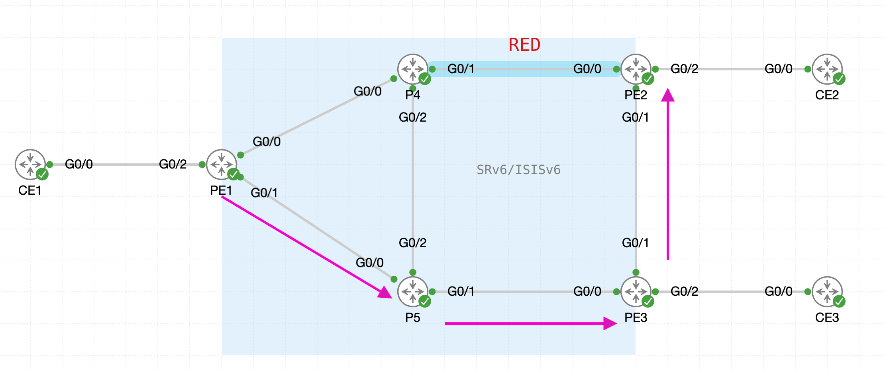
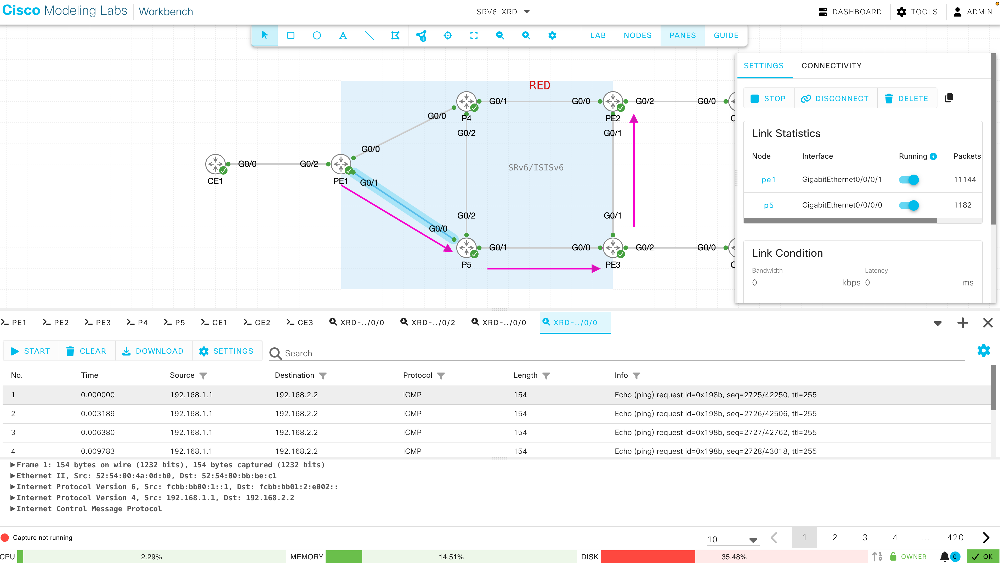
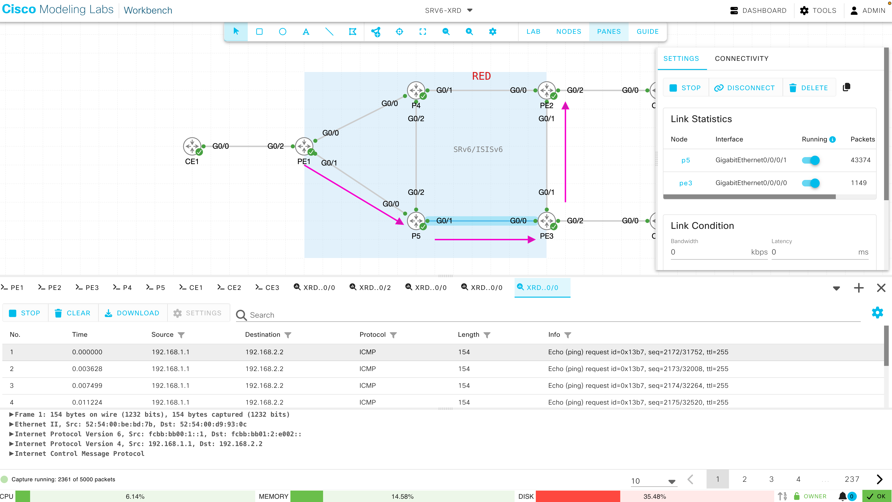
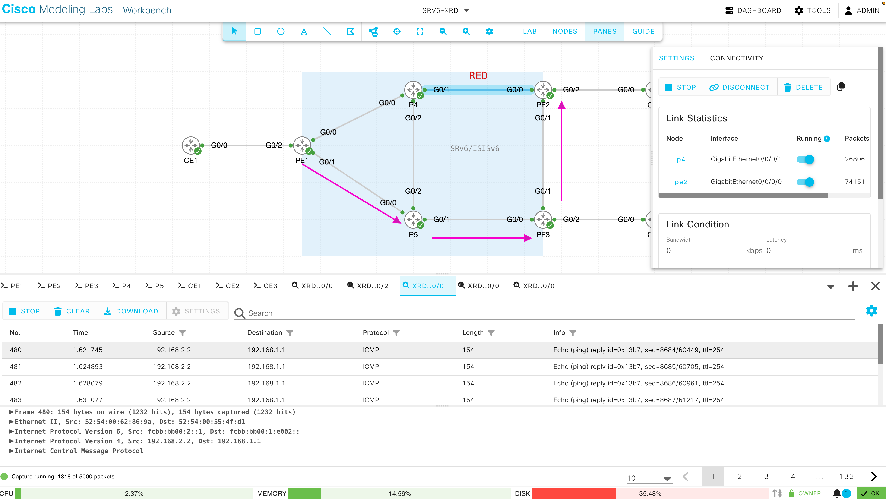

# 04. SRv6 Flex-Algo

## 4.1 Flex-Algo 定義と Affinity 設定

!!! abstract "ゴール"

```
特定のリンクにColorを付け、そのリンクを避ける Flex-Algo を定義すること
```

今回は、P4とPE2の間のリンクにColor: REDを設定し、PE1からPE2向けにREDのリンクを避けるようなパスを Flex-Algo 128 で計算させます。

{ style="width:100%" }

まず、REDリンクの両端であるPE2とP4に、IS-IS の Flex-Algo 用 Affinity の設定を行います。

```
router isis core
 affinity-map RED bit-position 3
 interface GigabitEthernet 0/0/0/1
  affinity flex-algo RED
 !
!
```

次に、全てのルータ（PE1 ~ P5）で Flex-Algo 128 を定義します。Flex-Algo 128 は、Color RED のリンクを除外 (exclude-any) し、IGP メトリックで最短パスを計算するアルゴリズムとなります。

- Flex-Algo のパスは、同じ Flex-Algo に参加している全てのルータでホップバイホップに計算されるため、全てのルータに設定します。
- `advertise-definition` により、Flex-Algo の定義 (FAD) を IS-IS で広報します。

```
router isis core
 affinity-map RED bit-position 3
 flex-algo 128
  advertise-definition
  affinity exclude-any RED
  !
 !
!
```

Flex-Algo 128 の定義を確認します。（PE1 ~ P5）

```
RP/0/RP0/CPU0:PE1#show isis flex-algo 128
Sun Oct 18 19:37:56.756 UTC

IS-IS core Flex-Algo Database

Flex-Algo 128:

  Level-2:
    Definition Priority: 128
    Definition Source: PE1.00, (Local)
    Definition Equal to Local: Yes
    Definition Metric Type: IGP
    Definition Flex-Algo Prefix Metric: No
    Exclude Any Affinity Bit Positions: 3
    Include Any Affinity Bit Positions:
    Include All Affinity Bit Positions:
    Reverse Exclude Any Affinity Bit Positions:
    Reverse Include Any Affinity Bit Positions:
    Reverse Include All Affinity Bit Positions:
    Exclude SRLGs:
    Minimum Link Bandwidth: 0 kbits/sec, (0 bytes/sec)
    Maximum Link Delay: 0 us
    Disabled: No

  Topologies supported:
    IPv6 Unicast

  Local Priority: 128
  FRR Disabled: No
  Microloop Avoidance Disabled: No
  UCMP Disabled: No

  Data Plane Segment Routing: Yes
  Data Plane IP: No

RP/0/RP0/CPU0:PE1#
```


## 4.2 Flex-Algo 用 Locator 設定

!!! abstract "ゴール"

```
Flex-Algo 128 用の Locator を設定し、REDリンクを避けた経路が計算されることを確認すること
```

{ style="width:100%" }

SRv6 では、Locator ごとにアルゴリズムを指定します。Flex-Algo 128 用の Locator を全てのルータ（PE1 ~ P5）に設定し、IS-IS で広報します。

- Locator のプレフィックスは、ルータ番号に応じて `fcbb:bb01:N::/48` に変更してください。

```
segment-routing
 srv6
  locators
   locator ALGO128
    micro-segment behavior unode psp-usd
    prefix fcbb:bb01:1::/48
    algorithm 128
   !
  !
 !
!
router isis core
 address-family ipv6 unicast
  segment-routing srv6
   locator ALGO128
   !
  !
 !
!
```

Locator の状態を確認します。（PE1 ~ P5）

```
RP/0/RP0/CPU0:PE1#show segment-routing srv6 locator
Sun Oct 18 19:48:30.610 UTC
Name                  ID       Algo  Prefix                    Status   Flags   
--------------------  -------  ----  ------------------------  -------  --------
ALGO128               1        128   fcbb:bb01:1::/48          Up       U       
MAIN                  2        0     fcbb:bb00:1::/48          Up       U 
```

Algo 128の経路を確認します。

```
RP/0/RP0/CPU0:PE1#show isis ipv6 route flex-algo 128
Sun Oct 18 20:01:22.479 UTC

Maximum parallel path count: 8

C  fcbb:bb01:1::/48
     is directly connected, SRv6Locator
L2 fcbb:bb01:2::/48 [31/115]
     via fe80::5054:ff:febb:bec1, GigabitEthernet0/0/0/1, P5, Weight: 0
L2 fcbb:bb01:3::/48 [21/115]
     via fe80::5054:ff:febb:bec1, GigabitEthernet0/0/0/1, P5, Weight: 0
L2 fcbb:bb01:4::/48 [11/115]
     via fe80::5054:ff:fec1:f132, GigabitEthernet0/0/0/0, P4, Weight: 0
L2 fcbb:bb01:5::/48 [11/115]
     via fe80::5054:ff:febb:bec1, GigabitEthernet0/0/0/1, P5, Weight: 0
RP/0/RP0/CPU0:PE1#
```

PE1 にて、PE2 の 2 つの Locator 向けの経路を比較します。

アルゴリズム 0 (通常の IGP 最短パス) の Locator `fcbb:bb00:2::/48` は P4 方向 (GigE0/0/0/0) ですが、Flex-Algo 128 の Locator `fcbb:bb01:2::/48` は REDリンクを避けて P5 方向 (GigE0/0/0/1) となっていることがわかります。

```
RP/0/RP0/CPU0:PE1#show route ipv6 fcbb:bb00:2::/48
Sun Oct 18 20:01:53.480 UTC

Routing entry for fcbb:bb00:2::/48
  Known via "isis core", distance 115, metric 21, SRv6-locator, type level-2
  Installed Oct 18 19:48:34.487 for 00:13:19
  Routing Descriptor Blocks
    fe80::5054:ff:fec1:f132, from fcbb:bb00:2::1, via GigabitEthernet0/0/0/0
      Route metric is 21
  No advertising protos. 
RP/0/RP0/CPU0:PE1#
RP/0/RP0/CPU0:PE1#show route ipv6 fcbb:bb01:2::/48
Sun Oct 18 20:01:59.626 UTC

Routing entry for fcbb:bb01:2::/48
  Known via "isis core", distance 115, metric 31, SRv6-locator (algo 128), type level-2
  Installed Oct 18 20:00:16.428 for 00:01:43
  Routing Descriptor Blocks
    fe80::5054:ff:febb:bec1, from fcbb:bb00:2::1, via GigabitEthernet0/0/0/1
      Route metric is 31
  No advertising protos. 
RP/0/RP0/CPU0:PE1#
```

P4でも確認すると、PE2 と直接接続しているにも関わらず、Flex-Algo 128 の Locator `fcbb:bb01:2::/48` 向けの経路は REDリンクを使わず P5 経由となっていることがわかります。このように、Flex-Algo では経路上の全てのルータが同じ制約でパスを計算します。

```
RP/0/RP0/CPU0:P4#show route ipv6 fcbb:bb01:2::/48
Sun Oct 18 20:02:42.742 UTC

Routing entry for fcbb:bb01:2::/48
  Known via "isis core", distance 115, metric 31, SRv6-locator (algo 128), type level-2
  Installed Oct 18 20:00:16.429 for 00:02:26
  Routing Descriptor Blocks
    fe80::5054:ff:fe3f:fcba, from fcbb:bb00:2::1, via GigabitEthernet0/0/0/2
      Route metric is 31
  No advertising protos. 
RP/0/RP0/CPU0:P4#
```


## 4.3 VPN サービスの Flex-Algo へのステアリング

!!! abstract "ゴール"

```
PE1からPE2向けのVPNトラフィックが Flex-Algo 128 のパスで転送されるようにすること
```

Egress PE である**PE2**にて、VRF CustA のサービス SID を Flex-Algo 128 の Locator (ALGO128) から割り当てるように変更します。

```
router bgp 65000
 vrf CustA
  address-family ipv4 unicast
   segment-routing srv6
    locator ALGO128
   !
  !
 !
!
```

PE2 にて、VRF CustA の uDT4 SID が ALGO128 の Locator から割り当てられたことを確認します。

```
RP/0/RP0/CPU0:PE2#show segment-routing srv6 sid
Sun Oct 18 20:04:02.093 UTC

*** Locator: 'ALGO128' *** 

SID                         Behavior          Identification                    Owner               State  RW
--------------------------  ----------------  --------------------------------  ------------------  -----  --
fcbb:bb01:2::               uN (PSP/USD)      'default':2                       sidmgr              InUse  Y 
fcbb:bb01:2:e000::          uA (PSP/USD)      [Gi0/0/0/0, Link-Local]:128       isis-core           InUse  Y 
fcbb:bb01:2:e001::          uA (PSP/USD)      [Gi0/0/0/1, Link-Local]:128       isis-core           InUse  Y 
fcbb:bb01:2:e002::          uDT4              'CustA'                           bgp-65000           InUse  Y 

*** Locator: 'MAIN' *** 

fcbb:bb00:2::               uN (PSP/USD)      'default':2                       sidmgr              InUse  Y 
fcbb:bb00:2:e000::          uA (PSP/USD)      [Gi0/0/0/1, Link-Local]:0         isis-core           InUse  Y 
fcbb:bb00:2:e001::          uA (PSP/USD)      [Gi0/0/0/0, Link-Local]:0         isis-core           InUse  Y 
RP/0/RP0/CPU0:PE2#
```

PE1 にて、PE2 から受信した SID が ALGO128 の Locator 配下の SID に変わったことを確認します。BGP のネクストホップは変わらず fcbb:bb00:2::1 のままです。

```
RP/0/RP0/CPU0:PE1#show bgp vpnv4 unicast received-sids
Sun Oct 18 20:05:12.796 UTC
BGP router identifier 1.1.1.1, local AS number 65000
BGP generic scan interval 60 secs
Non-stop routing is enabled
BGP table state: Active
Table ID: 0x0
BGP main routing table version 16
BGP NSR Initial initsync version 7 (Reached)
BGP NSR/ISSU Sync-Group versions 0/0
BGP scan interval 60 secs

Status codes: s suppressed, d damped, h history, * valid, > best
              i - internal, r RIB-failure, S stale, N Nexthop-discard
Origin codes: i - IGP, e - EGP, ? - incomplete
   Network            Next Hop                            Received Sid
Route Distinguisher: 1.1.1.1:100 (default for vrf CustA)
Route Distinguisher Version: 16
*> 192.168.1.0/24     0.0.0.0                             NO SRv6 Sid
*>i192.168.2.0/24     fcbb:bb00:2::1                      fcbb:bb01:2:e002::
*>i192.168.3.0/24     fcbb:bb00:3::1                      fcbb:bb00:3:e002::
Route Distinguisher: 2.2.2.2:100
Route Distinguisher Version: 15
*>i192.168.2.0/24     fcbb:bb00:2::1                      fcbb:bb01:2:e002::
Route Distinguisher: 3.3.3.3:100
Route Distinguisher Version: 13
*>i192.168.3.0/24     fcbb:bb00:3::1                      fcbb:bb00:3:e002::

Processed 5 prefixes, 5 paths
RP/0/RP0/CPU0:PE1#
```

PE1 にて CEF を確認すると、192.168.2.0/24 宛のトラフィックは Flex-Algo 128 の SID (fcbb:bb01:2:e002::) でカプセル化され、Flex-Algo 128 の Locator 向けの経路に従って P5 方向 (GigE0/0/0/1) に転送されることがわかります。

SRv6-TE ポリシーのように SIDリストを積む必要はなく、宛先の SID が 1 つだけで REDリンクを避けた転送が実現できます。

```
RP/0/RP0/CPU0:PE1#show cef vrf CustA 192.168.2.2
Sun Oct 18 20:06:15.312 UTC
192.168.2.0/24, version 8, SRv6 Headend, internal 0x5000001 0x30 (ptr 0x8aafe750) [1], 0x0 (0x0), 0x0 (0x8a8f27c8)
 Updated Oct 18 20:04:40.763
 Prefix Len 24, traffic index 0, precedence n/a, priority 3
  gateway array (0x8ab012a8) reference count 1, flags 0x2010, source rib (7), 0 backups
                [1 type 3 flags 0x48441 (0x897c8880) ext 0x0 (0x0)]
  LW-LDI[type=0, refc=0, ptr=0x0, sh-ldi=0x0]
  gateway array update type-time 1 Oct 18 20:04:40.764
 LDI Update time Oct 18 20:04:40.764

  Level 1 - Load distribution: 0
  [0] via fcbb:bb01:2::/128, recursive

   via fcbb:bb01:2::/128, 3 dependencies, recursive [flags 0x6000]
    path-idx 0 NHID 0x0 [0x894d33a0 0x0]
    next hop VRF - 'default', table - 0xe0800000
    next hop fcbb:bb01:2::/128 via fcbb:bb01:2::/48
    SRv6 H.Encaps.Red SID-list {fcbb:bb01:2:e002::}

    Load distribution: 0 (refcount 1)

    Hash  OK  Interface                 Address
    0     Y   GigabitEthernet0/0/0/1    fe80::5054:ff:febb:bec1

RP/0/RP0/CPU0:PE1#
```


## 4.4 パケットキャプチャ

!!! abstract "ゴール"

```
PE1からPE2向けのトラフィックが Flex-Algo 128 のパスで転送されることをキャプチャで確認する
```

Flex-Algo 128 のパスが通るリンクでパケットキャプチャを開始します。

{ style="width:100%" }

そして、PE1にて192.168.2.2向けにPingを行います。

```
RP/0/RP0/CPU0:PE1#ping vrf CustA 192.168.2.2 count 10000        
Tue Jan  6 05:32:35.006 UTC
Type escape sequence to abort.
Sending 100, 100-byte ICMP Echos to 192.168.2.2 timeout is 2 seconds:
!!!!!!!!!!!!!!!!!!!!!!!!!!!!!!!!!!!!!!!!!!!!!!!!!!!!!!!!!!!!!!!!!!!!!!
!!!!!!!!!!!!!!!!!!!!!!!!!!!!!!
```

例えば、PE1からP5の間のパケットキャプチャを確認すると、PE1からのICMP requestが Flex-Algo 128 の SID (fcbb:bb01:2:e002::) を宛先とする IPv6 ヘッダでカプセル化されて転送されていることがわかります。

{ style="width:100%" }

P5からPE3の間でも、同じ宛先アドレスのまま転送されていることを確認できます。P5 及び PE3 は、Flex-Algo 128 の Locator (fcbb:bb01:2::/48) の経路に従って転送しています。

{ style="width:100%" }

一方、PE2からのICMP replyに関しては、PE1 の VRF CustA の SID は通常の Locator (MAIN) から割り当てられているため、IGP最短パスで転送されます。P4とPE2の間でパケットキャプチャをすると、下記のようにICMP replyのみが PE1 の uDT4 SID (fcbb:bb00:1:e002::) を宛先として転送されていることがわかります。

{ style="width:100%" }

## 4.5 設定削除

!!! abstract "ゴール"

```
次のシナリオのために設定を削除します。
```

全てのPEにてCE向けインタフェース、VRF、BGP設定を削除します（PE1 ~ PE3）

```
no vrf CustA
no router bgp
int GigabitEthernet 0/0/0/2
 no vrf CustA
!
```

また、全てのルータでAlgo128の設定を削除します。

```
router isis core
 no flex-algo 128
 address-family ipv6 unicast
  segment-routing srv6
   no locator ALGO128
  !
 !
!
segment-routing
 srv6
  locators
   no locator ALGO128
  !
 !
!
```

