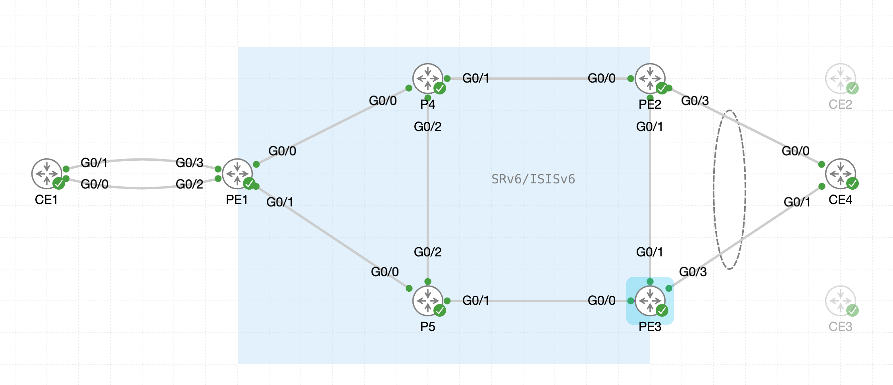

# 05. SRv6 EVPN VPWS

## 5.1 CE向けインタフェースの設定

!!! abstract "ゴール"

```
PEルータにCE向けインタフェースの設定を行うこと
```

今回のEVPN-VPWSシナリオでは、Windows側は１台のPEルータ（PE1）のみに接続するシングルホーミング構成、Ubuntu側は２台のPEルータ（PE2とPE3）に接続するマルチホーミング構成を想定します。

!!! note "マルチホーミングのモードについて"

```
本ラボで使用する XRd (IOS XR 26.1.1) では、SRv6 EVPN VPWS のマルチホーミングはポートアクティブ (Port-Active) モードのみサポートされています。そのため、本ラボではポートアクティブ構成とし、2 台の PE のうち 1 台のみがトラフィックを転送します。
```

{ style="width:100%" }

まず、シングルホーミング構成のPEルータ（PE1）のCE向けインタフェースの設定は下記のように行います。

```
interface GigabitEthernet0/0/0/3
 l2transport
 !
!
```

次に、マルチホーミング構成のPEルータ（PE2とPE3）のCE向けインタフェース設定を行います。System Mac は同じ値を設定します。

```
interface Bundle-Ether1
 lacp system mac 2323.2323.2323
 l2transport
 !
!
interface GigabitEthernet 0/0/0/3
 bundle id 1 mode active
 no shut
!
```


## 5.2 PEルータでSRv6 EVPNとXCONNECT設定

!!! abstract "ゴール"

```
PEルータ（PE1〜PE3）にてEVPNでSRv6を有効化し、XCONNECT設定を行うこと
```

全てのPE（PE1〜PE3）にて、EVPN で使用する SRv6 Locator を指定します。

```
evpn
 segment-routing srv6
  locator MAIN
 !
 evi 100 segment-routing srv6
!
```

また、PE2とPE3にESIの設定を行います。

```
evpn
 interface Bundle-Ether1
  ethernet-segment
   identifier type 0 23.23.00.00.00.00.00.00.00
   load-balancing-mode port-active
  !
 !
!
```

全てのPE（PE1〜PE3）にてXCONNECTの設定を行います。

- `service` で両端共通のサービス ID を指定し、`segment-routing srv6` で SRv6 を転送プレーンとして使用します。
- CE向けインタフェースは、PE1 では Gig0/0/0/3、PE2 と PE3 では Bundle-Ether1 を指定します。

PE1

```
l2vpn
 xconnect group 100
  p2p vpws100
   interface GigabitEthernet0/0/0/3
   neighbor evpn evi 100 service 100 segment-routing srv6
   !
  !
 !
!
```

PE2/PE3

```
l2vpn
 xconnect group 100
  p2p vpws100
   interface Bundle-Ether1
   neighbor evpn evi 100 service 100 segment-routing srv6
   !
  !
 !
!
```

現時点では、XCONNECTがUPしていないことを確認します。

```
RP/0/RP0/CPU0:PE1#show l2vpn xconnect 
Sun Oct 18 20:50:16.976 UTC
Legend: ST = State, UP = Up, DN = Down, AD = Admin Down, UR = Unresolved,
        SB = Standby, SR = Standby Ready, (PP) = Partially Programmed,
        LU = Local Up, RU = Remote Up, CO = Connected, (SI) = Seamless Inactive

XConnect                   Segment 1                       Segment 2                
Group      Name       ST   Description            ST       Description            ST    
------------------------   -----------------------------   -----------------------------
100        vpws100    DN   Gi0/0/0/3              UP       EVPN 100,100,None      DN    
----------------------------------------------------------------------------------------
RP/0/RP0/CPU0:PE1#
```


## 5.3 MP-BGP 設定

!!! abstract "ゴール"

```
リモートPE間でBGPセッションを確立すること
```

PE ルータにてBGP を設定（PE1 ~ PE3）

- router-id は、設定対象ルータの IPv4 ループバックアドレスに変更してください。
- ネイバーアドレスは、他PEの IPv6 ループバックアドレスを設定してください。

```
router bgp 65000
 bgp router-id 1.1.1.1
 address-family l2vpn evpn
 !
 neighbor-group PEs
  remote-as 65000
  update-source Loopback0
  address-family l2vpn evpn
  !
 !
 neighbor fcbb:bb00:2::1
  use neighbor-group PEs
 !
 neighbor fcbb:bb00:3::1
  use neighbor-group PEs
 !
!
```

PE間でBGPが上がっていることを確認します。（PE1 ~ PE3）

```
RP/0/RP0/CPU0:PE1#show bgp l2vpn evpn neighbors brief
Sun Oct 18 20:59:11.979 UTC

Neighbor         Spk    AS  Description                         Up/Down  NBRState
fcbb:bb00:2::1    0 65000                                      00:00:13 Established 
fcbb:bb00:3::1    0 65000                                      00:00:15 Established 
RP/0/RP0/CPU0:PE1#
```

少し時間をおいて、XCONNECTステートを確認します。PE2もしくはPE3のいずれかがスタンバイになっており、Downしていることがわかります。

```
RP/0/RP0/CPU0:PE1#show l2vpn xconnect 
Mon Oct 19 00:14:27.552 UTC
Legend: ST = State, UP = Up, DN = Down, AD = Admin Down, UR = Unresolved,
        SB = Standby, SR = Standby Ready, (PP) = Partially Programmed,
        LU = Local Up, RU = Remote Up, CO = Connected, (SI) = Seamless Inactive

XConnect                   Segment 1                       Segment 2                
Group      Name       ST   Description            ST       Description            ST    
------------------------   -----------------------------   -----------------------------
100        vpws100    UP   Gi0/0/0/3              UP       EVPN 100,100,::ffff:10.0.0.1 
                                                                                  UP    
----------------------------------------------------------------------------------------
RP/0/RP0/CPU0:PE1#
```

```
RP/0/RP0/CPU0:PE2#show l2vpn xconnect 
Mon Oct 19 00:16:18.677 UTC
Legend: ST = State, UP = Up, DN = Down, AD = Admin Down, UR = Unresolved,
        SB = Standby, SR = Standby Ready, (PP) = Partially Programmed,
        LU = Local Up, RU = Remote Up, CO = Connected, (SI) = Seamless Inactive

XConnect                   Segment 1                       Segment 2                
Group      Name       ST   Description            ST       Description            ST    
------------------------   -----------------------------   -----------------------------
100        vpws100    UP   BE1                    UP       EVPN 100,100,::ffff:10.0.0.1 
                                                                                  UP    
----------------------------------------------------------------------------------------
RP/0/RP0/CPU0:PE2#
```

```
RP/0/RP0/CPU0:PE3#show l2vpn xconnect 
Mon Oct 19 00:16:25.295 UTC
Legend: ST = State, UP = Up, DN = Down, AD = Admin Down, UR = Unresolved,
        SB = Standby, SR = Standby Ready, (PP) = Partially Programmed,
        LU = Local Up, RU = Remote Up, CO = Connected, (SI) = Seamless Inactive

XConnect                   Segment 1                       Segment 2                
Group      Name       ST   Description            ST       Description            ST    
------------------------   -----------------------------   -----------------------------
100        vpws100    DN   BE1                    UP       EVPN 100,100,::ffff:10.0.0.1 
                                                                                  SB    
----------------------------------------------------------------------------------------
RP/0/RP0/CPU0:PE3#
```

また、detail をつけて確認すると、リモート PE の uDX2 SID も確認できます。uDX2 は「カプセル化を解除して、特定の L2 インタフェース (AC) に転送する」という動作を表し、SR-MPLS の PW ラベルに相当します。ポートアクティブ構成のため、本来はRemote には DF である PE2 の SID のみが表示されます。

```
RP/0/RP0/CPU0:PE1#show l2vpn xconnect detail
Mon Oct 19 00:25:38.269 UTC

Group 100, XC vpws100, state is up; Interworking none
Decoupled mode: Disabled
  AC: GigabitEthernet0/0/0/3, state is up
    Type Ethernet
    MTU 1500; XC ID 0x1; interworking none
    Statistics:
      packets: received 0, sent 0
      bytes: received 0, sent 0
  EVPN: neighbor ::ffff:10.0.0.1, PW ID: evi 100, ac-id 100, state is up ( established )
    XC ID 0xfff80001
    Encapsulation SRv6
    Encap type Ethernet
    Ignore MTU mismatch: Enabled
    Transmit MTU zero: Enabled
    Reachability: Up
    Force PW UP: Inactive
    Nexthop type: Internal ID ::ffff:10.0.0.1

      SRv6              Local                        Remote                      
      ----------------  ---------------------------- --------------------------
      uDX2              fcbb:bb00:1:e002::           fcbb:bb00:2:e001::
      AC ID             100                          100                         
      MTU               1514                         0                           
      Locator           MAIN                         N/A                         
      Locator Resolved  Yes                          N/A                         
      SRv6 Headend      H.Encaps.L2.Red              N/A                         
    Statistics:
      packets: received 0, sent 0
      bytes: received 0, sent 0
RP/0/RP0/CPU0:PE1#
```

PE2, PE3にてEthernet Segment情報を確認します。NextHopを見ると2 つの PE で同じESIが共有されていることがわかります。また、Port-Activeで動作しており、一方の PE (下記の例では PE2) が DF (Designated Forwarder) として選出されていることがわかります。

```
RP/0/RP0/CPU0:PE2#show evpn ethernet-segment esi 0023.2300.0000.0000.0000 detail
Mon Oct 19 00:16:05.106 UTC

Ethernet Segment Id      Interface                          Originating IP      
------------------------ ---------------------------------- --------------------
0023.2300.0000.0000.0000 BE1                                2.2.2.2
                                                            3.3.3.3
  ES to BGP Gates   : Ready
  ES to L2FIB Gates : Ready
  Main port         :
     Interface name : Bundle-Ether1
     Interface MAC  : 0030.8546.0233
     IfHandle       : 0x00000024
     State          : Up
     Redundancy     : Not Defined
  ESI ID            : 1
  ESI type          : 0
     Value          : 0023.2300.0000.0000.0000
  ES Import RT      : 2323.0000.0000 (from ESI)
  Topology          :
     Operational    : MH
     Configured     : Port-Active
  Service Carving   : Auto-selection
     Multicast      : Disabled
  Convergence       : 
  Peering Details   : 2 Nexthops
     2.2.2.2 [MOD:P:00:T]
     3.3.3.3 [MOD:P:00:T]
  Service Carving Synchronization:
     Mode           : NONE
     Peer Updates   :
                 2.2.2.2 [SCT: N/A]
                 3.3.3.3 [SCT: N/A]
  Service Carving Results:
     Forwarders     : 1
     Elected        : 0
     Not Elected    : 0
  EVPN-VPWS Service Carving Results:
     Primary        : 1
     Backup         : 0
     Non-DF         : 0
  MAC Flush msg     : STP-TCN
  Peering timer     : 3 sec [not running]
  Recovery timer    : 30 sec [not running]
  Carving timer     : 0 sec [not running]
  Revert timer      : 0 sec [not running]
  HRW Reset timer   : 5 sec [not running]
  Local SHG filters :
      (mpls)                None
      (srv6)                1:16
  Remote SHG filters: 1
      (srv6)                1:16 : nexthop fcbb:bb00:3::1
  Access signal mode: Bundle Hot-Standby

RP/0/RP0/CPU0:PE2#
```

DF に選出されなかった PE (下記の例では PE3) では、バンドルが LACP により Out of Service (OOS) となり、待機状態となっていることがわかります。

```
RP/0/RP0/CPU0:PE3#show bundle bundle-ether 1
Mon Oct 19 00:22:26.236 UTC

Bundle-Ether1
  Status:                                    LACP OOS (out of service)
  Local links <active/standby/configured>:   0 / 1 / 1
  Local bandwidth <effective/available>:     0 (0) kbps
  MAC address (source):                      0004.c14c.a2e8 (Chassis pool)
  Inter-chassis link:                        No
  Minimum active links / bandwidth:          1 / 1 kbps
  Maximum active links:                      64
  Wait while timer:                          2000 ms
  Load balancing:                            
    Link order signaling:                    Not configured
    Hash type:                               Default
    Locality threshold:                      None
  LACP:                                      Operational
    Flap suppression timer:                  Off
    Cisco extensions:                        Disabled
    Non-revertive:                           Disabled
  mLACP:                                     Not configured
  IPv4 BFD:                                  Not configured
  IPv6 BFD:                                  Not configured

  Port                  Device           State        Port ID         B/W, kbps
  --------------------  ---------------  -----------  --------------  ----------
  Gi0/0/0/3             Local            Standby      0x8000, 0x0001     1000000
      Link is in standby due to bundle out of service state
RP/0/RP0/CPU0:PE3#
```


SRv6 SID の一覧を確認すると、EVPN VPWS 用の uDX2 SID が確認できます。（PE1 ~ PE3）

```
RP/0/RP0/CPU0:PE1#show segment-routing srv6 sid
Mon Oct 19 00:25:11.504 UTC

*** Locator: 'MAIN' *** 

SID                         Behavior          Identification                    Owner               State  RW
--------------------------  ----------------  --------------------------------  ------------------  -----  --
fcbb:bb00:1::               uN (PSP/USD)      'default':1                       sidmgr              InUse  Y 
fcbb:bb00:1:e000::          uA (PSP/USD)      [Gi0/0/0/0, Link-Local]:0         isis-core           InUse  Y 
fcbb:bb00:1:e001::          uA (PSP/USD)      [Gi0/0/0/1, Link-Local]:0         isis-core           InUse  Y 
fcbb:bb00:1:e002::          uDX2              100:100                           l2vpn_srv6          InUse  Y 
RP/0/RP0/CPU0:PE1#
```

EVPN で使用している SRv6 Locator も確認できます。（PE1 ~ PE3）

```
RP/0/RP0/CPU0:PE1#show evpn segment-routing srv6
Mon Oct 19 00:24:54.288 UTC

Configured default locator: MAIN
Configured default SID Function Length: 16 bits
EVIs with unknown locator config: 0
VPWS with unknown locator config: 0
Global SID Function Length: 16 bits

Locator name    Prefix                      OOR      Flags                   Service count    SID count    
------------    ------                      ---      -----                   -------------    ---------    
MAIN            fcbb:bb00:1::/48            False    micro-segment           1                1            
RP/0/RP0/CPU0:PE1#
```


## 5.4 VPWS 設定の削除

!!! abstract "ゴール"

```
VPWS設定を削除すること
```

全てのPEにてCE向けインタフェース、EVPN設定を削除します（PE1 ~ PE3）

```
no evpn
no l2vpn
```

SRv6 EVPN-VPWSのシナリオは以上です。