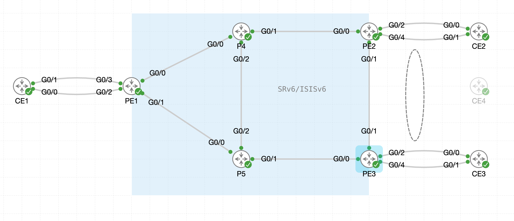

# 06. SRv6 EVPN ELAN

## 6.1 CE向けインタフェースの設定

!!! abstract "ゴール"

```
PEルータにCE向けインタフェースの設定を行うこと
```

今回のEVPN-ELANシナリオでは、下記のように全てのPE-CE間がシングルホーミング構成であることを想定します。

{ style="width:100%" }

まず、PE2, PE3のCE向けインタフェースの設定を下記のように行います。

```
interface GigabitEthernet 0/0/0/4
 l2transport
 !
!
```

## 6.2 SRv6 EVPN とブリッジドメイン設定

!!! abstract "ゴール"

```
PEルータ（PE1〜PE3）にてEVPNでSRv6を有効化し、ブリッジドメインの設定を行うこと
```

全てのPEルータ（PE1〜PE3）に下記設定を行います。

- `evpn` 配下で、EVPN で使用する SRv6 Locator を指定します。
- `evi 100 segment-routing srv6` により、EVI 100 の転送プレーンとして SRv6 を使用します。

PE1

```
evpn
 segment-routing srv6
  locator MAIN
 !
 evi 100 segment-routing srv6
 !
!
l2vpn
 bridge group BRIDGE
  bridge-domain BRIDGE_evi_100
   interface GigabitEthernet0/0/0/3
   !
   evi 100 segment-routing srv6
   !
  !
 !
!
```

PE2/PE3

```
evpn
 segment-routing srv6
  locator MAIN
 !
 evi 100 segment-routing srv6
 !
!
l2vpn
 bridge group BRIDGE
  bridge-domain BRIDGE_evi_100
   interface GigabitEthernet0/0/0/4
   !
   evi 100 segment-routing srv6
   !
  !
 !
!
```

ブリッジドメインのstateが上がっていることを確認します。（PE1 ~ PE3）

```
RP/0/RP0/CPU0:PE1#show l2vpn bridge-domain bd-name BRIDGE_evi_100
Mon Oct 19 00:32:27.182 UTC
Legend: pp = Partially Programmed.
Bridge group: BRIDGE, bridge-domain: BRIDGE_evi_100, id: 0, state: up, ShgId: 0, MSTi: 0
  Aging: 300 s, MAC limit: 4000, Action: none, Notification: syslog
  Filter MAC addresses: 0
  ACs: 1 (1 up), VFIs: 0, PWs: 0 (0 up), PBBs: 0 (0 up), VNIs: 0 (0 up)
  List of EVPNs:
    EVPN, state: up
  List of ACs:
    Gi0/0/0/3, state: up, Static MAC addresses: 0, MSTi: 5
  List of Access PWs:
  List of VFIs:
  List of Access VFIs:
RP/0/RP0/CPU0:PE1#
```


## 6.3 MP-BGP 設定

!!! abstract "ゴール"

```
リモートPE間での BGP セッションの確立を確認すること
```

先ほどのVPWSとコントロールプレーン設定は共通となります。

PE ルータにてBGP 設定（PE1 ~ PE3）を確認します。

```
RP/0/RP0/CPU0:PE1#show run router bgp
Tue Jan  6 01:56:45.996 UTC
router bgp 65000
 bgp router-id 1.1.1.1
 address-family l2vpn evpn
 !
 neighbor-group PEs
  remote-as 65000
  update-source Loopback0
  address-family l2vpn evpn
  !
 !
 neighbor fcbb:bb00:2::1
  use neighbor-group PEs
 !
 neighbor fcbb:bb00:3::1
  use neighbor-group PEs
 !
!

RP/0/RP0/CPU0:PE1#
```

PE間でBGPが上がっていることを確認します。（PE1 ~ PE3）

```
RP/0/RP0/CPU0:PE1#show bgp l2vpn evpn neighbors brief
Wed Dec 24 08:08:32.313 UTC

Neighbor         Spk    AS  Description                         Up/Down  NBRState
fcbb:bb00:2::1    0 65000                                      00:00:32 Established 
fcbb:bb00:3::1    0 65000                                      00:00:11 Established 
RP/0/RP0/CPU0:PE1#
```

EVIの詳細を確認します。（PE1 ~ PE3）

Encap が SRv6 となっており、SR-MPLS の Unicast/Multicast Label の代わりに Unicast/Multicast SID が割り当てられていることを確認できます。また、今回はRDとRTは明示的に設定していないため、下記のパラメータが選択されていることがわかります。

- EVI BGP RD - $ROUTER-ID:$EVI
- EVI BGP RT - $AS:$EVI

Advertise MACを現在設定していないため、Noになっています。

```
RP/0/RP0/CPU0:PE1#show evpn evi vpn-id 100 detail
Mon Oct 19 00:33:10.915 UTC

VPN-ID     Encap      Bridge Domain                Type               
---------- ---------- ---------------------------- -------------------
100        SRv6       BRIDGE_evi_100               EVPN               
   Stitching: Regular
   Unicast SID:  fcbb:bb00:1:e002::                     
   Multicast SID:  fcbb:bb00:1:e003::                     
   E-Tree: Root
   Forward-class: 0
   Advertise MACs: No
   Advertise BVI MACs: No
   Aliasing: Enabled
   UUF: Enabled
   Re-origination: Enabled
   Multicast:
     IGMP-Snooping Proxy: No
     MLD-Snooping Proxy : No
   BGP Implicit Import: Enabled
   VRF Name: 
   Preferred Nexthop Mode: Off
   BVI Coupled Mode: No
   BVI Subnet Withheld: ipv4 No, ipv6 No
   L3VRF Label Mode: Per-VRF
          
   Statistics:
     Packets            Sent                 Received
       Total          : 0                    0                   
       Unicast        : 0                    0                   
       BUM            : 0                    0                   
     Bytes              Sent                 Received
       Total          : 0                    0                   
       Unicast        : 0                    0                   
       BUM            : 0                    0                   
   RD Config: none
   RD Auto  : (auto) 1.1.1.1:100
   RT Auto  : 65000:100
   Route Targets in Use           Type                 
   ------------------------------ ---------------------
   65000:100                      Import               
   65000:100                      Export               

RP/0/RP0/CPU0:PE1#
```

SRv6 SID の一覧でも、Unicast 用の uDT2U SID と BUM (Broadcast, Unknown unicast, Multicast) 用の uDT2M SID が存在していることを確認します。（PE1 ~ PE3）

- uDT2U: カプセル化を解除して、L2 テーブル (MAC テーブル) をルックアップして転送
- uDT2M: カプセル化を解除して、ブリッジドメイン内にフラッディング

```
RP/0/RP0/CPU0:PE1#show segment-routing srv6 sid
Mon Oct 19 00:33:59.587 UTC

*** Locator: 'MAIN' *** 

SID                         Behavior          Identification                    Owner               State  RW
--------------------------  ----------------  --------------------------------  ------------------  -----  --
fcbb:bb00:1::               uN (PSP/USD)      'default':1                       sidmgr              InUse  Y 
fcbb:bb00:1:e000::          uA (PSP/USD)      [Gi0/0/0/0, Link-Local]:0         isis-core           InUse  Y 
fcbb:bb00:1:e001::          uA (PSP/USD)      [Gi0/0/0/1, Link-Local]:0         isis-core           InUse  Y 
fcbb:bb00:1:e002::          uDT2U             100:0                             l2vpn_srv6          InUse  Y 
fcbb:bb00:1:e003::          uDT2M             100:0                             l2vpn_srv6          InUse  Y 
RP/0/RP0/CPU0:PE1#
```

しかし、EVPNによるMAC アドバタイズメントを有効にしていないため、下記のようにMAC学習がされていないことがわかります。

```
RP/0/RP0/CPU0:PE1#show evpn evi mac
Mon Oct 19 00:34:12.713 UTC

VPN-ID     Encap      MAC address    IP address                               Nexthop                                 Label    SID                                    
---------- ---------- -------------- ---------------------------------------- --------------------------------------- -------- ---------------------------------------
RP/0/RP0/CPU0:PE1#
```


## 6.4 MAC Advertisement設定

!!! abstract "ゴール"

```
MACアドバタイズメントを有効にし、相互にMAC学習をすること
```

PE ルータにてMACアドバタイズメントを有効化（PE1 ~ PE3）

```
evpn
 evi 100 segment-routing srv6
  advertise-mac
  !
 !
!
```

この設定により、RT-2のMAC advertisementのやりとりが開始され、学習したローカルおよびリモートの MAC アドレス及び対応する SID の確認ができるようになります。リモートの MAC アドレス宛のフレームは、リモート PE の uDT2U SID でカプセル化されて転送されます。

```
RP/0/RP0/CPU0:PE1#show evpn evi mac
Tue Jan  6 05:27:41.011 UTC

VPN-ID     Encap      MAC address    IP address     Nexthop                 Label    SID
---------- ---------- -------------- -------------- ----------------------- -------- ---------------------
100        SRv6       0050.56aa.91c5 ::             fcbb:bb00:2::1          IMP-NULL fcbb:bb00:2:e002::
100        SRv6       0050.56aa.ba57 ::             HundredGigE0/0/0/2      0        fcbb:bb00:1:e002::
100        SRv6       0050.56aa.7173 ::             fcbb:bb00:3::1          IMP-NULL fcbb:bb00:3:e002::
RP/0/RP0/CPU0:PE1#
```

PE間でやりとりされるBGP EVPNルートは ” show bgp l2vpn evpn” コマンドで確認できます。（オプション）

```
RP/0/RP0/CPU0:PE1#show bgp l2vpn evpn
Mon Oct 19 00:37:22.824 UTC
BGP router identifier 1.1.1.1, local AS number 65000
BGP generic scan interval 60 secs
Non-stop routing is enabled
BGP table state: Active
Table ID: 0x0
BGP main routing table version 23
BGP NSR Initial initsync version 1 (Reached)
BGP NSR/ISSU Sync-Group versions 0/0
BGP scan interval 60 secs

Status codes: s suppressed, d damped, h history, * valid, > best
              i - internal, r RIB-failure, S stale, N Nexthop-discard
Origin codes: i - IGP, e - EGP, ? - incomplete
   Network            Next Hop            Metric LocPrf Weight Path
Route Distinguisher: 1.1.1.1:100 (default for vrf BRIDGE_evi_100)
Route Distinguisher Version: 23
*> [2][0][48][5254.004e.55de][0]/104
                      0.0.0.0                                0 i
*>i[2][0][48][5254.00cd.0293][0]/104
                      fcbb:bb00:2::1                100      0 i
*>i[2][0][48][86ae.e4a5.9215][0]/104
                      fcbb:bb00:3::1                100      0 i
*>i[2][0][48][be0e.ba32.3fce][0]/104
                      fcbb:bb00:2::1                100      0 i
*> [3][0][32][1.1.1.1]/80
                      0.0.0.0                                0 i
*>i[3][0][32][2.2.2.2]/80
                      fcbb:bb00:2::1                100      0 i
*>i[3][0][32][3.3.3.3]/80
                      fcbb:bb00:3::1                100      0 i
Route Distinguisher: 2.2.2.2:100
Route Distinguisher Version: 22
*>i[2][0][48][5254.00cd.0293][0]/104
                      fcbb:bb00:2::1                100      0 i
*>i[2][0][48][be0e.ba32.3fce][0]/104
                      fcbb:bb00:2::1                100      0 i
*>i[3][0][32][2.2.2.2]/80
                      fcbb:bb00:2::1                100      0 i
Route Distinguisher: 3.3.3.3:100
Route Distinguisher Version: 19
*>i[2][0][48][86ae.e4a5.9215][0]/104
                      fcbb:bb00:3::1                100      0 i
*>i[3][0][32][3.3.3.3]/80
                      fcbb:bb00:3::1                100      0 i

Processed 12 prefixes, 12 paths
RP/0/RP0/CPU0:PE1#
```

下記のように、RT-2 アドバタイズメントの詳細を確認することもできます。MACアドレス0050.56aa.7173はPE3（fcbb:bb00:3::1）から受け取っており、BGP の Prefix-SID 属性に PE3 の uDT2U SID の情報（Locator fcbb:bb00:3:: と Received Label 0xe00100、Behavior 67 = uDT2U）が含まれていることがわかります。（オプション）

```
RP/0/RP0/CPU0:PE1#show bgp l2vpn evpn rd 3.3.3.3:100 [2][0][48][86ae.e4a5.9215][0]/104
Mon Oct 19 00:38:17.840 UTC
BGP routing table entry for [2][0][48][86ae.e4a5.9215][0]/104, Route Distinguisher: 3.3.3.3:100
Versions:
  Process           bRIB/RIB   SendTblVer
  Speaker                 19           19
Last Modified: Oct 19 00:34:46.668 for 00:03:31
Paths: (1 available, best #1)
  Not advertised to any peer
  Path #1: Received by speaker 0
  Not advertised to any peer
  Local
    fcbb:bb00:3::1 (metric 20) from fcbb:bb00:3::1 (3.3.3.3)
      Received Label 0xe00100
      Origin IGP, localpref 100, valid, internal, best, group-best, import-candidate, not-in-vrf
      Received Path ID 0, Local Path ID 1, version 19
      Extended community: Flags 0x10: SoO:3.3.3.3:100 RT:65000:100 
      EVPN ESI: 0000.0000.0000.0000.0000
      PSID-Type:L2, SubTLV Count:1
       SID Locator: fcbb:bb00:3::/48, RIB metric: 21
       SubTLV:
        T:1(Sid information), Sid:fcbb:bb00:3::(Transposed), Behavior:67, SS-TLV Count:1
         SubSubTLV:
          T:1(Sid structure):
RP/0/RP0/CPU0:PE1#
```

また、RT-3でやりとりされるBUMトラフィック用の uDT2M SID の情報（Function e003、Behavior 68 = uDT2M）が確認できます。（オプション）

```
RP/0/RP0/CPU0:PE1#show bgp l2vpn evpn rd 3.3.3.3:100 [3][0][32][3.3.3.3]/80
Mon Oct 19 00:41:11.034 UTC
BGP routing table entry for [3][0][32][3.3.3.3]/80, Route Distinguisher: 3.3.3.3:100
Versions:
  Process           bRIB/RIB   SendTblVer
  Speaker                 15           15
Last Modified: Oct 19 00:32:17.668 for 00:08:53
Paths: (1 available, best #1)
  Not advertised to any peer
  Path #1: Received by speaker 0
  Not advertised to any peer
  Local
    fcbb:bb00:3::1 (metric 20) from fcbb:bb00:3::1 (3.3.3.3)
      Origin IGP, localpref 100, valid, internal, best, group-best, import-candidate, not-in-vrf
      Received Path ID 0, Local Path ID 1, version 15
      Extended community: EVPN L2 ATTRS:0x00:0 RT:65000:100 
      PMSI: flags 0x00, type 6, label 0xe00300, ID 0x03030303
      PSID-Type:L2, SubTLV Count:1
       SID Locator: fcbb:bb00:3::/48, RIB metric: 21
       SubTLV:
        T:1(Sid information), Sid:fcbb:bb00:3::(Transposed), Behavior:68, SS-TLV Count:1
         SubSubTLV:
          T:1(Sid structure):
RP/0/RP0/CPU0:PE1#
```


## 6.5 ELAN 設定の削除

!!! abstract "ゴール"

```
ELAN設定を削除すること
```

全てのPEにてCE向けインタフェース、EVPN設定を削除します（PE1 ~ PE3）

```
no evpn
no l2vpn
no router bgp
```

SRv6 EVPN-ELANのシナリオは以上です。

設定を初期化する場合は、下記の設定を削除してください。

```
no router isis core 
no segment-routing
```

