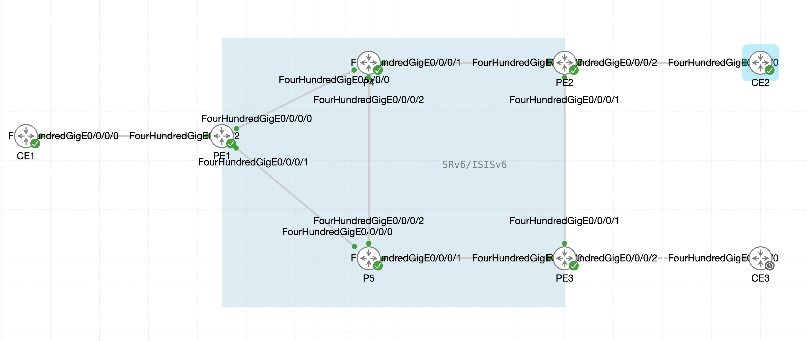

# SRv6 ラボ

このラボでは、CML 上の IOS XR ルータを使って SRv6 (uSID) の基本設定から L3VPN、SRv6-TE、Flex-Algo、EVPN までを順に体験します。

## ラボ一覧


| No. | ラボ                                                   |
| --- | ---------------------------------------------------- |
| 01  | [SRv6 基本設定](01-srv6-basic/index.md)                  |
| 02  | [SRv6 L3VPN](02-l3vpn/index.md)                      |
| 03  | [SRv6-TE Explicit Path](03-srv6te-explicit/index.md) |
| 04  | [SRv6 Flex-Algo](04-flex-algo/index.md)              |
| 05  | [SRv6 EVPN VPWS](05-evpn-vpws/index.md)              |
| 06  | [SRv6 EVPN ELAN](06-evpn-elan/index.md)              |
| 07  | [SR-MPLS から SRv6 への移行](07-srmpls-to-srv6/index.md)   |


## ラボについて

{ style="width:100%" }

## アドレス設計

本ラボでは、コア網 (PE-P 間) を IPv6 のみで構成し、IGP には IS-IS を使用します。各ルータには以下のアドレスと SRv6 Locator を設定します（N はルータ番号）。


| ルータ | 役割  | Router ID (IPv4 Loopback0) | IPv6 Loopback0     | SRv6 Locator (MAIN) | SRv6 Locator (ALGO128) |
| --- | --- | -------------------------- | ------------------ | ------------------- | ---------------------- |
| PE1 | PE  | 1.1.1.1                    | fcbb:bb00:1::1/128 | fcbb:bb00:1::/48    | fcbb:bb00:101::/48     |
| PE2 | PE  | 2.2.2.2                    | fcbb:bb00:2::1/128 | fcbb:bb00:2::/48    | fcbb:bb00:102::/48     |
| PE3 | PE  | 3.3.3.3                    | fcbb:bb00:3::1/128 | fcbb:bb00:3::/48    | fcbb:bb00:103::/48     |
| P4  | P   | 4.4.4.4                    | fcbb:bb00:4::1/128 | fcbb:bb00:4::/48    | fcbb:bb00:104::/48     |
| P5  | P   | 5.5.5.5                    | fcbb:bb00:5::1/128 | fcbb:bb00:5::/48    | fcbb:bb00:105::/48     |


- SRv6 SID は uSID フォーマット F3216（uSID Block 32 bit: `fcbb:bb00::/32`、uSID 16 bit）を使用します。
- コアリンクにはグローバル IPv6 アドレスを設定せず、`ipv6 enable` によるリンクローカルアドレスのみで動作させます。
- ALGO128 の Locator は [04. SRv6 Flex-Algo](04-flex-algo/index.md) で使用します。

!!! note "出力例について"

```
本ガイドに記載しているコマンド出力は参考例です。SID の Function 値（`e000`、`e002` など）、リンクローカルアドレス、タイムスタンプなどは環境により異なる場合があります。
```


## 次のステップ

 [01. SRv6 基本設定](01-srv6-basic/index.md) に進んでください。